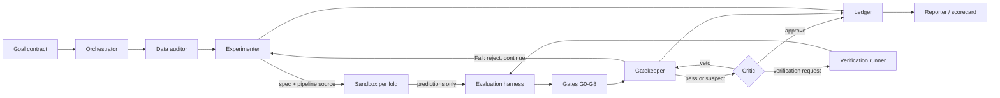

# Architecture

Validity by construction: agents cannot reach the evaluator or the hidden
lockbox, cannot modify the evaluator, and cannot bypass hard validity rules. Two
components are LLM agents; everything else is deterministic software.

## Components

| Component | Type | Role |
| --- | --- | --- |
| Goal contract | Input | Dataset, target, task, metric, constraints, prediction-time available features, optional group and time columns |
| Orchestrator (LangGraph) | Deterministic | Controls flow, enforces iteration, time and token caps, scopes each agent's context. Makes no ML decisions |
| Split manager | Deterministic | Builds folds, groups exact duplicates, honors declared group and time columns, holds the hidden lockbox |
| Data auditor | Deterministic | Profiles the selection pool only: missingness, imbalance, duplicates, ID-like columns, shortcut screens |
| **Experimenter** | **LLM** | Reads contract, audit report and ledger; writes the experiment spec and pipeline source; chooses refine, rerun, submit or stop |
| Sandbox executor | Deterministic | Fresh process per fold, no network, no lockbox, resource caps. Returns predictions only |
| Evaluation harness | Deterministic | Computes all metrics and cost outside the sandbox |
| Gatekeeper | Deterministic | Applies hard gate rules and produces the verdict; no LLM can override a Fail |
| **Critic** | **LLM** | Read-only review of audit report, gate table, metrics, pipeline source and ledger summaries. Cannot see the Experimenter's reasoning or edit code |
| Verification runner | Deterministic | Runs approved requests from a fixed menu |
| Ledger | Deterministic | Append-only record of every decision |
| Lockbox check | Deterministic | One-shot final score with no feedback into the loop |
| Reporter | Deterministic | Templated scorecard and report; optional LLM narrative cannot change the verdict |

**Authority order:** Gatekeeper Fail > Critic veto > Gatekeeper Pass.

## Data flow

At the end of a run the system performs one lockbox check and emits the
verdict. The lockbox result never feeds back into the loop.

## Isolation invariants

1. The lockbox is never mounted in the sandbox.
2. The oracle set is never visible to the platform; only benchmark tooling reads
   it.
3. Metrics are computed only outside the sandbox.
4. Fold boundaries and preprocessing fit are enforced by the interface, not by
   agent discipline.
5. Agent output is untrusted: no network, read-only data, fresh process, CPU,
   memory and time caps.
6. A hard Fail is terminal for the candidate and cannot be overridden.
7. Every decision is appended to the ledger and traceable to a code hash.

## Gate status versus verdict

Gates report Pass, Fail, Suspect or Not applicable. The verdict is derived from
the gate table, never from a weighted score:

| Any Fail | Unresolved Suspect | Goal met | Label |
| --- | --- | --- | --- |
| Yes | – | – | Invalid |
| No | Yes | – | Suspect / unresolved |
| No | No | Yes | Valid and performant |
| No | No | No | Valid but underperforming |

## Technology stack

- Python, Pydantic, pandas, NumPy
- LangGraph for orchestration, LangSmith for tracing
- scikit-learn, XGBoost, LightGBM; AutoGluon as reference
- Docker for sandbox and reproducible environment
- FastAPI and a lightweight static frontend for the read-only dashboard
- Append-only JSONL ledger
- pytest, GitHub, GitHub Actions

One pinned LLM backbone, accessed through an API behind a small provider
abstraction.

## Mapping components to code

See [file-structure.md](file-structure.md). Each package in `src/amlab/`
corresponds to one row of the component table, except
`contracts/` (shared schemas) and `cli/` (entry point).
